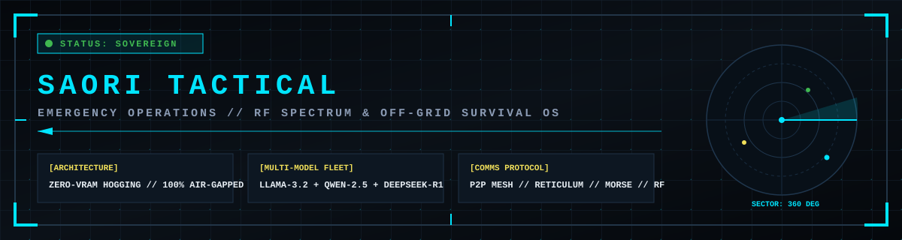

<div align="center">



# SAORI TACTICAL
### SOVEREIGN EMERGENCY RESPONSE, RF SPECTRUM & OFF-GRID SURVIVAL OPERATING SYSTEM

**[AIR-GAPPED DEFENSE GRADE]** &bull; **[ZERO-VRAM HOGGING]** &bull; **[P2P MESH STORE-AND-FORWARD]** &bull; **[100% OFFLINE]**

</div>

---

## 1. RESUMEN EJECUTIVO Y DOCTRINA DE OPERACION

SAORI TACTICAL es una estacion de inteligencia local soberana disenada para operar en escenarios de fallo catastrofico de infraestructura civil:
* Blackout electrico total y corte prolongado de red publica.
* Caida de conectividad WAN, colapso de fibra optica y destruccion de torres de telefonia celular.
* Aislamiento geografico y necesidad de telecomunicaciones tacticas en radiofrecuencia (VHF/UHF, HF, Morse, APRS).
* Operacion continua sobre fuentes de energia de contingencia (baterias de ciclo profundo, paneles solares sin regulador o alternador de vehiculo en ralenti).

El sistema se ejecuta localmente acelerado por GPU (NVIDIA RTX 4060 8GB / CUDA) o CPU x86_64 / ARM64, implementando una **Politica Estricta de Cero Retencion de Memoria (Zero-VRAM Hogging)** para evitar la degradacion termica y el consumo parasito de energia.

---

## 2. ARQUITECTURA DEL SISTEMA

```
+-----------------------------------------------------------------------------+
|                          SAORI TACTICAL SYSTEM CORE                         |
+-----------------------------------------------------------------------------+
|                                                                             |
|  [CENTINELA DE RED]          [MODULO HARDWARE & PC]       [PUENTE ANDROID]  |
|  Failover Multi-Interfaz     Monitoreo Bateria / UPS      Sensores ADB      |
|  Ethernet / Wi-Fi / Tether   Telemetria CPU / RAM / VRAM  Signal RSRP dBm   |
|                                                                             |
|  [BAUL TACTICO & GRAFO]      [WIKI INGENIERIA CAMPO]      [ESTUDIO RF/MORSE]|
|  Protocolos Trauma MARCH     12 Planos Constructivos      Traduccion Auto   |
|  Grafo Cero Tokens (<5ms)    Filtros / Antenas / Energia  Audio 44.1kHz WAV |
|                                                                             |
|  [FLOTA MULTI-MODELO]        [ZERO-VRAM CONTROLLER]       [MALLA P2P MESH]  |
|  Llama 3.2 3B (Tactico)      keep_alive: 1m               Broadcast UDP     |
|  Qwen 2.5 Coder (SRE/Win)    Auto-purga inmediata 0 MB    Store-and-Forward |
|  DeepSeek R1 (Analista)      Descarga total al salir      Buzon SITREP      |
|                                                                             |
+-----------------------------------------------------------------------------+
```

---

## 3. FLOTA MULTI-MODELO LOCAL & POLITICA ZERO-VRAM

A diferencia de sistemas monoliticos, SAORI TACTICAL segmenta la resolucion de contingencias en tres roles de inteligencia artificial local:

| Rol Táctico | Identificador del Modelo | Parámetros | Enlace al Modelo Oficial | Propósito Operativo |
| :--- | :--- | :---: | :--- | :--- |
| **TACTICAL** | `llama3.2:3b` | 3.21B | [Llama 3.2 3B en Ollama](https://ollama.com/library/llama3.2:3b) | Triage militar MARCH, medicina de trauma, potabilizacion de agua, protocolos de desastres y frecuencias de radio. |
| **CODER** | `qwen2.5-coder:3b` | 3.09B | [Qwen 2.5 Coder 3B en Ollama](https://ollama.com/library/qwen2.5-coder:3b) | Ingenieria de sistemas en Windows, scripting PowerShell/Python, diagnostico de hardware y reparacion de red sin internet. |
| **ANALYST** | `deepseek-r1:1.5b` | 1.78B | [DeepSeek R1 1.5B en Ollama](https://ollama.com/library/deepseek-r1:1.5b) | Razonamiento logico deductivo, desglose de problemas complejos y planificacion de contingencias criticas. |

### Doctrina Zero-VRAM Hogging
1. **Inferencia Bajo Demanda**: Los modelos se cargan en la VRAM de la GPU solo en el instante en que el operador emite una consulta.
2. **Auto-Descarga (keep_alive: 1m)**: Cada llamada de inferencia instruye al motor a descargar automaticamente el modelo de la memoria de video tras 60 segundos de inactividad.
3. **Purga Forzada Inmediata (0 MB)**: La instruccion `unload` fuerza a Ollama a purgar inmediatamente la GPU, garantizando **0 MB de VRAM ocupada**.
4. **Cierre Limpio**: Al salir de la consola interactiva con `q`, SAORI Tactical ejecuta una purga integral antes de finalizar el proceso.

> **NOTA SOBRE LAYER OFFLOADING SECUENCIAL (AIRLLM):**  
> AirLLM permite ejecutar modelos de 70B transfiriendo capa por capa desde un SSD NVMe a la GPU, pero genera a solo **0.5 tokens/segundo** y mantiene la CPU, bus PCIe y disco al 100% de uso continuo. En una contingencia operando con reserva de bateria o generador, un modelo cuantizado 3B en VRAM directa genera a **70+ tokens/segundo** en 2 segundos y apaga la GPU, maximizando la eficiencia por Watt.

---

## 4. INSTALACION Y DESPLIEGUE AUTOMATIZADO

### Requisitos Minimos de Hardware
* **CPU**: x86_64 multinucleo (Intel Core i5/i7/i9 o AMD Ryzen) o ARM64.
* **Memoria RAM**: 8 GB minimo (16 GB recomendado).
* **GPU**: Aceleradora NVIDIA compatible con CUDA (Recomendado: RTX 3060/4060 8GB o superior) o inferencia por CPU.
* **Almacenamiento**: 10 GB de espacio libre en disco SSD.
* **Sistema Operativo**: Windows 10/11, Linux (Ubuntu/Debian) o Android Termux.

### Despliegue en Windows (Automatizado)
Ejecutar el script instalador desde una consola con permisos estandar:
```cmd
install.bat
```
El instalador ejecuta secuencialmente:
1. Verificacion de entorno Python 3.10+.
2. Instalacion de dependencias de `requirements.txt`.
3. Verificacion del motor Ollama (instalacion automatica si no existe).
4. Descarga automatizada de la Flota Multi-Modelo (`llama3.2:3b`, `qwen2.5-coder:3b`, `deepseek-r1:1.5b`).
5. Purga inicial de VRAM (0 MB residentes).

### Despliegue en Linux / macOS / Android Termux (Automatizado)
```bash
chmod +x install.sh
./install.sh
```

---

## 5. MODULOS OPERATIVOS

### A. Radiofrecuencia, Estudio Morse y Fonetico (`radio/`)
* **Traductor Bidireccional Automatico**: Identifica texto en lenguaje natural o codigo Morse y ejecuta la conversion simultanea con deletreo fonetico OACI / OTAN.
* **Sintesis y Exportacion de Audio**: Sintetizador senoidal a 700 Hz con exportacion a archivo de audio PCM estandar WAV (16-bit 44.1 kHz) para transmision por equipos de radio.
* **Frecuencias de Emergencia Preconfiguradas**:
  * Bomberos Nacional: `155.000 VHF FM`
  * Red Nacional de Emergencia (RNE): `154.570 VHF FM`
  * SENAPRED Nacional: `7.150 MHz HF LSB`
  * Radioaficionados CE3 / FEDERACHI: `146.520 VHF FM` / `7.090 MHz HF`
  * Maritimo Canal 16: `156.800 VHF FM` (Mayday / Pan-Pan)
  * Aeronautico Emergencia: `121.500 MHz AM`
  * Banda Ciudadana CB: `Canal 9 (27.065 AM)` y `Canal 19 (27.185 AM)`
  * Montana PMR446: `Canal 7 subtono 7 (446.08125 MHz)`
* **Herramientas de Calculo**: Calculador de offset de repetidoras VHF (+0.600 MHz) y UHF (+5.000 MHz) y conversor de coordenadas a QTH Locator (Maidenhead).

### B. Malla P2P Cyberpunk & Store-and-Forward DTN (`comms/`)
* **Descubrimiento Descentralizado por Broadcast UDP**: Descubrimiento automatico de nodos en subred local a traves del puerto `53530` sin enrutador comercial ni servidores DNS.
* **Buzon Tactico Store-and-Forward**: Protocolo para redes con tolerancia a retardo (DTN). Los reportes de situacion (SITREP) se almacenan localmente en `data/mesh_mailbox.json` y se replican de forma asincrona cuando dos nodos entran en cobertura Wi-Fi Direct o Bluetooth.

### C. Estacion de Sensores Android ADB (`comms/android_bridge.py`)
* Enlace con dispositivos moviles Android conectados por cable USB o Wi-Fi ADB.
* Extraccion en tiempo real de potencia de senal celular LTE en dBm (RSRP/RSRQ), torre conectada y operador mediante volcado de telemetria.
* Escaneo de redes Wi-Fi perimetrales utilizando el hardware de radio del smartphone sin interrumpir los adaptadores del PC.

### D. Wiki de Construccion e Ingenieria de Campo (`knowledge/offline_wiki.py`)
Contiene 12 planos tecnicos integrados para construccion y supervivencia:
1. `WIKI-ENERGIA-AUTO-12V-220V`: Generacion electrica continua con motor de automovil en ralenti (alternador 70A-120A e inversor 12V a 220V Onda Pura).
2. `WIKI-INYECCION-CASA-LUCES`: Protocolo seguro de energizacion del circuito de alumbrado de una vivienda (aislamiento obligatorio de red publica para evitar electrocucion de tecnicos).
3. `WIKI-ROUTER-12V-DIRECTO`: Alimentacion directa de routers y terminales ONT de fibra a 12V DC sin inversor (eliminando 25% de perdidas termicas).
4. `WIKI-PANEL-SOLAR-EMERGENCIA`: Uso de paneles solares recuperados sin regulador de carga (diodo de bloqueo Schottky de 10A-15A y control a 14.4V).
5. `WIKI-BANOS-SECOS-SANITARIOS`: Protocolo sanitario de dos baldes (Twin-Bucket) y mitigacion del 95% del mal olor con ceniza y carbon activado.
6. `WIKI-ANTENA-CHATARRA-ZINC`: Fabricacion de dipolos y reflectores de esquina directivos (+12 dBi) con planchas de calamina/zinc y escombros.
7. `WIKI-RED-CYBERPUNK-MESH-LOCAL`: Arquitectura de red mallada P2P para ciudadela aislada (Blackwall Citadel).
8. `WIKI-ANTENA-SLIMJIM`: Antena omnidireccional VHF 2m (146 MHz) con cable coaxial (alcance triplicado de 3 km a 25 km).
9. `WIKI-ANTENA-YAGI-3E`: Antena direccional de 3 elementos con ganancia de +7 dBi para enlaces a mas de 50 km usando cinta metrica de carpintero.
10. `WIKI-FILTRO-BIOARENA`: Filtro lento de bio-arena, grava y carbon activado (20 litros/dia de purificacion bacteriana y mecanica).
11. `WIKI-BANCO-12V-OFFGRID`: Instalacion de banco de baterias de ciclo profundo con fusibles de proteccion ANL.
12. `WIKI-DESTILADOR-SOLAR`: Foso de condensacion solar para extraccion de 1.5 litros/dia de agua pura de tierra o agua salada.
13. `WIKI-REFUGIO-AFRAME`: Trinchera termica con aislamiento por aire atrapado (+10 deg C interior a 0 deg C exterior sin fuego).

---

## 6. GUIA DE COMANDOS DE LINEA DE ORDENES

```cmd
:: 1. HUD TACTICO INTERACTIVO DE CAMPO
saori.bat

:: 2. CONSULTAS TACTICAS AL MOTOR LOCAL
saori.bat query "hemorragia arterial pierna torniquete"
saori.bat query "script powershell listar adaptadores caidos" --role coder
saori.bat query "plan de contingencia sin agua por 7 dias" --role analyst
saori.bat query "protocolo terremoto santiago" --voice

:: 3. CONSULTA DE PLANOS CONSTRUCTIVOS EN WIKI OFFLINE
saori.bat wiki
saori.bat wiki antena
saori.bat wiki auto
saori.bat wiki bano
saori.bat wiki solar
saori.bat wiki mesh

:: 4. ESTUDIO MORSE, AUDIO Y CODIGOS Q
saori.bat morse "MAYDAY SOS ATENCION"
saori.bat morse "... --- ... / .- -.-- ..- -.. .-"
saori.bat morse "SOS" --audio
saori.bat morse "SOS" --wav data\alerta.wav

:: 5. FRECUENCIAS DE RADIO DE EMERGENCIA
saori.bat radio "Bomberos"
saori.bat radio "Canal 16"
saori.bat radio "SENAPRED"

:: 6. TELEMETRIA DE HARDWARE, BATERIA Y GPU
saori.bat pc

:: 7. PUENTE ANDROID ADB (SENSORES Y TELEMETRIA CELULAR)
saori.bat android
saori.bat android wifi
saori.bat android cmd "getprop ro.product.model"

:: 8. GESTION DE RED MALLADA P2P
saori.bat mesh
saori.bat mesh send "SITREP 01: Perimetro seguro, generador en linea"

:: 9. CONTROL DE VRAM Y FLOTA
saori.bat role coder
saori.bat role analyst
saori.bat role tactical
saori.bat unload

:: 10. SERVIDOR WEB TACTICO PARA SMARTPHONES Y TABLETS
saori.bat web --port 8090
```

---

## 7. RESOLUCION DE PROBLEMAS OPERATIVOS (TROUBLESHOOTING)

### [FALLO]: El demonio Ollama no responde o rechaza la conexion
* **Causa**: El proceso de fondo no se inicio o el puerto `11434` esta ocupado.
* **Resolucion**:
  ```powershell
  Get-Process ollama -ErrorAction SilentlyContinue
  Start-Process -NoNewWindow ollama "serve"
  ```

### [FALLO]: La memoria VRAM permanece ocupada tras finalizar consultas
* **Causa**: Inferencia detenida sin senal de purga.
* **Resolucion**: Ejecutar `saori.bat unload`. El comando envia `keep_alive: 0` al endpoint de API liberando el 100% de la memoria grafica.

### [FALLO]: Dispositivo Android no detectado en `saori.bat android`
* **Causa**: Cable exclusivamente de carga, depuracion USB desactivada o falta de autorizacion RSA de clave de host.
* **Resolucion**:
  1. Habilitar **Opciones de desarrollador** > **Depuracion USB** en el telefono.
  2. Conectar cable USB de transferencia de datos.
  3. Desbloquear pantalla y marcar **"Permitir siempre desde esta computadora"**.
  4. Reiniciar demonio ADB:
     ```cmd
     adb kill-server
     adb start-server
     adb devices
     ```

### [FALLO]: Bloqueo de audio Morse en navegador movil
* **Causa**: Politica de proteccion Autoplay de Web Audio API en navegadores moviles.
* **Resolucion**: El operador debe realizar un toque en cualquier elemento de la pantalla antes de accionar el control de reproduccion de audio.

---

## 8. INTEGRIDAD Y LICENCIA

Este software ha sido disenado para uso en defensa civil, radioaficion y respuesta ante emergencias y catastrofes. El codigo se distribuye bajo licencia **MIT** de codigo abierto sin garantias implicitas de disponibilidad de red publica.
