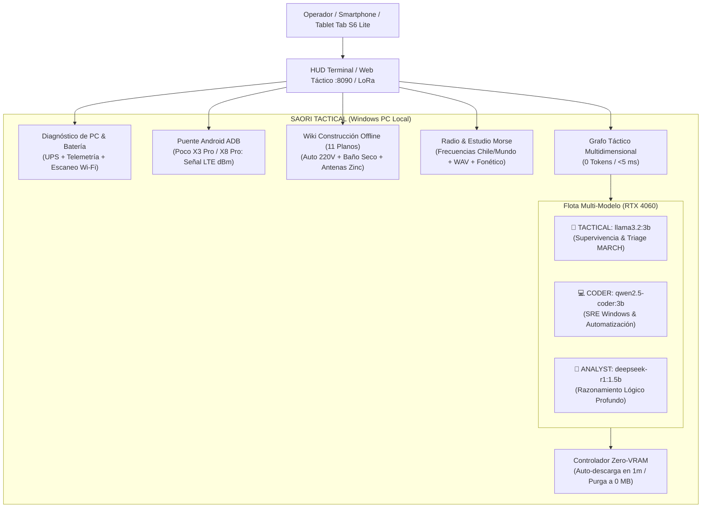

# 📡 SAORI TACTICAL // Sovereign Emergency, Survival & RF Operating System

> **Estación Táctica de Inteligencia Local para Desastres, Señales de Radio, Energía Off-Grid y Supervivencia Civil.**  
> Acelerado 100% en la GPU local **NVIDIA GeForce RTX 4060 (8GB VRAM)**. Cero dependencia de internet obligatoria.  
> **Política Zero-VRAM Hogging**: Los modelos solo se cargan en demanda y se descargan automáticamente para no consumir recursos del PC innecesariamente.

---

## 🎯 Arquitectura y Diferenciadores Clave



---

## 🤖 1. Flota Multi-Modelo Local & Política Zero-VRAM

SAORI no es un bot genérico: cuenta con una flota local especializada para la RTX 4060:
* **`tactical` (`llama3.2:3b` - 1.88 GB)**: Triage médico militar MARCH, supervivencia extrema, potabilización de agua, terremotos 8.0+ y canales de radio.
* **`coder` (`qwen2.5-coder:3b` - 1.80 GB)**: Diagnóstico de hardware en Windows, scripts de PowerShell/Python, rescate de discos y reparación de interfaces de red sin internet.
* **`analyst` (`deepseek-r1:1.5b` - 1.04 GB)**: Razonamiento deductivo paso a paso y diseño de planes de contingencia ante fallas complejas.

### Política de VRAM (Zero-Hogging)
1. **Auto-descarga en 60 segundos**: Cada inferencia usa `keep_alive: 1m`. Si no hay nuevas preguntas, Ollama descarga el modelo de la GPU automáticamente.
2. **Purga inmediata**: Ejecutando `saori.bat unload` o el botón en la Web se fuerza la descarga inmediata dejando **0 MB de VRAM ocupada**.
3. **Cierre limpio**: Al salir de la consola interactiva con `q`, se purga la GPU antes de terminar.

> ℹ️ **¿Por qué no usar Layer Offloading desde SSD (estilo AirLLM)?**  
> AirLLM permite correr modelos de 70B en 4GB de VRAM cargando capa por capa desde un NVMe, pero la velocidad cae a **0.5 tokens/segundo** (una respuesta de 150 palabras tarda 5 minutos) y el SSD/CPU consumen el 100% de bus continuo. En un apagón operando sobre batería o alternador, un modelo cuantizado 3B o 7B en VRAM directa genera a **70+ tokens/segundo** en 2 segundos y apaga la GPU de inmediato, logrando la máxima eficiencia por Watt consumido.

---

## ⚡ 2. Energía & Electricidad Rústica (Estándar Chile 220V AC 50Hz)

En Chile la red opera a **220V AC a 50Hz**. Durante un apagón prolongado:

### A. Uso del Automóvil como Generador Eléctrico (Alternador + Batería)
* **Principio de funcionamiento**: La batería del auto entrega 12V DC. Al encender el motor y dejarlo en **ralentí (700-900 RPM)**, el alternador del auto genera entre **13.8V y 14.4V continuos** con una capacidad de **60A a 120A** (según el vehículo). Esto equivale a entre **700W y 1400W utilizables sostenidos**.
* **Conexión del Inversor 12V DC -> 220V AC**:
  1. **Directo a bornes de la batería**: Conectar cables gruesos de cobre (mínimo 6 AWG / 16 mm²) con pinzas de alta presión o pernos directamente a los bornes (+) y (-).
  2. **¡PELIGRO! NUNCA usar la toma del encendedor de cigarrillos interior**: Su fusible es de solo 10A-15A (~120W máximo) y se quemará al conectar una PC o refrigerador.
  3. **Ventilación obligatoria**: El auto debe estar **al aire libre**. El monóxido de carbono en garajes cerrados es letal en pocos minutos.
  4. **Consumo de combustible**: Un motor en ralentí consume aprox. **0.8 a 1.2 litros de bencina por hora**. Con medio estanque (25 litros) se puede mantener la PC, radio e iluminación funcionando por más de 24 horas continuas.
* **Cargas críticas**:
  * **PC de Escritorio / Torre**: Consume entre 150W y 250W. Requiere preferentemente inversor de **Onda Pura (Pure Sine Wave)** para proteger la fuente con PFC activo.
  * **Refrigerador**: Consume 150W continuos, pero el compresor genera un **pico inductivo de arranque de 800W a 1500W** durante 2 segundos. Requiere inversor con tolerancia surge de al menos 1200W.
  * **Router Wi-Fi**: Consume solo 12W. **¡No uses inversor para el router!** La mayoría de routers de fibra (Movistar, Entel, VTR) se alimentan internamente a **12V DC**. Se pueden conectar directo a la batería de 12V con un conector jack barril de 5.5mm x 2.1mm y un fusible de 2A, ahorrando un 25% de pérdida por conversión de calor.

### B. Conexiones Rústicas con Cables Pelados (Sin Enchufes)
* Si no dispones de alargadores o enchufes hembra:
  1. Pelar 3 cm de cobre en los extremos de los cables.
  2. Realizar un **empalme militar (Western Union splice)** trenzando firmemente el cobre para evitar puntos calientes por resistencia de contacto.
  3. **Aislamiento crítico**: Envolver cada conductor vivo por separado con un mínimo de **6 vueltas de cinta aisladora de PVC** o cinta vulcanizada (auto-amalgamante).
  4. **Protección mecánica**: Enfundar los cables en trozos de manguera de jardín de plástico para evitar cortes con escombros metálicos.
  5. **Separación física**: Mantener los conductores de Fase y Neutro separados físicamente al menos 10 cm mediante amarras plásticas a estructuras fijas.

### C. Paneles Solares sin Regulador Comercial
* Si encuentras un panel solar suelto (Voc ~18V-22V) y no tienes regulador PWM o MPPT:
  1. Instalar un **diodo de potencia Schottky de 10A-15A** en serie con el cable positivo del panel (con la banda plateada/cátodo apuntando hacia la batería). Esto permite la carga de día pero **bloquea la descarga de la batería hacia el panel durante la noche**.
  2. Monitorear el voltaje de la batería con multímetro: si alcanza **14.4V**, desconectar manualmente el panel para evitar que el electrolito hierva y libere gas hidrógeno inflamable.

---

## 🚽 3. Sanidad & Baño Seco de Emergencia (Twin-Bucket System)

En terremotos o desastres mayores, las cañerías matrices de agua y alcantarillado colapsan. Si los vecinos tiran la cadena con baldes de agua, colapsan los colectores y las aguas servidas rebasan los pisos inferiores.
* **Sistema de Dos Baldes (Twin-Bucket Emergency Sanitation)**:
  1. **Balde 1 (Solo Líquidos / Orina)**: La orina humana es estéril al salir del cuerpo y **no genera mal olor si no se mezcla con bacterias fecales**. Se vacía en tierra o drenajes diluida en agua 1:5.
  2. **Balde 2 (Solo Sólidos / Heces y Papel)**: Forrado con bolsa plástica gruesa de 50 litros.
* **Control y Mitigación del 95% del Mal Olor**:
  * Después de cada deposición en el balde de sólidos, cubrir inmediatamente con **dos tazas de mezcla seca** (50% aserrín o tierra de jardín seca + 50% ceniza tamizada de fogata o carbón vegetal molido).
  * El carbón vegetal adsorbe los compuestos volátiles de azufre y amoníaco en sus microporos, y la alcalinidad de la ceniza neutraliza la proliferación de bacterias anaeróbicas y moscas transmisoras de cólera y hepatitis.

---

## 🛠️ 4. Wiki de Construcción & Ingeniería de Campo (11 Planos)

Accesible por consola (`saori.bat wiki`) o desde la interfaz web móvil:
1. `WIKI-ENERGIA-AUTO-12V-220V`: Generación eléctrica con motor de auto, alternador e inversor a 220V.
2. `WIKI-ROUTER-12V-DIRECTO`: Alimentación directa de routers de fibra a 12V DC (Zero-Inverter).
3. `WIKI-PANEL-SOLAR-EMERGENCIA`: Uso rústico de paneles solares con diodo Schottky sin regulador.
4. `WIKI-BANOS-SECOS-SANITARIOS`: Baño seco de dos baldes y control bacteriano/olor con carbón.
5. `WIKI-ANTENA-CHATARRA-ZINC`: Dipolos y reflectores de esquina directivos (+12 dBi) con planchas de calamina/zinc.
6. `WIKI-ANTENA-SLIMJIM`: Antena vertical 2m VHF (146 MHz) con coaxial para triplicar alcance de Baofeng/Yaesu.
7. `WIKI-ANTENA-YAGI-3E`: Yagi direccional de 3 elementos para enlazar repetidoras a más de 50 km con cinta métrica.
8. `WIKI-FILTRO-BIOARENA`: Purificación bacteriológica casera (20 L/día) con capas de arena, grava y carbón activado.
9. `WIKI-BANCO-12V-OFFGRID`: Instalación segura de banco de baterías de ciclo profundo con fusibles ANL.
10. `WIKI-DESTILADOR-SOLAR`: Extracción pasiva de 1.5 L/día de agua pura a partir de agua marina o tierra.
11. `WIKI-REFUGIO-AFRAME`: Trinchera térmica aislada (+10°C interior con 0°C exterior sin fuego).

---

## 📱 5. Ecosistema de Dispositivos Conectados

### A. Poco X3 Pro (LineageOS FOSS sin Google, Snapdragon 860)
* **La Estación Táctica de Radio & Sensores**:
  * Conectado por cable USB con **Depuración USB (ADB)** activada.
  * SAORI lee en tiempo real el nivel de señal celular en dBm (RSRP/RSRQ), operador (Entel, WOM, Movistar, Claro) y torre conectada con `adb shell dumpsys telephony.registry`.
  * Utiliza el chip Wi-Fi del Poco X3 Pro para escanear redes circundantes sin ocupar el adaptador del PC (`saori.bat android wifi`).
  * Puede operar como módem USB tethering de alta velocidad o radio SDR conectando un dongle USB OTG.
  * Posee **emisor infrarrojo (IR Blaster)** para controlar televisores, equipos de sonido o generadores compatibles en apagón.

### B. Poco X8 Pro (HyperOS Xiaomi)
* Compatible mediante **Depuración USB** por cable o Wi-Fi ADB.
* Puede operar como nodo anexo de procesamiento corriendo `llama.cpp` o servidores de respaldo en Termux.

### C. Tablet Samsung Galaxy Tab S6 Lite 2021 (10.4" con S-Pen)
* **La Terminal Táctica de Campo (HUD Portátil)**:
  * Permite apagar el monitor grande del PC (ahorrando 150W de electricidad).
  * Conectada por Wi-Fi al Hotspot de la PC (`http://192.168.137.1:8090`), su batería de 7040 mAh entrega más de 12 horas continuas para consultar la Wiki de construcción con zoom, usar el S-Pen para croquis y enviar consultas al LLM local.

### D. Laptop Nova (Intel i7 + GeForce MX450)
* Nodo portátil satélite / hot-spare. Puede sincronizar los archivos de SAORI y asumir la operación si la PC de escritorio agota su reserva de energía.

---

## 📻 6. Estudio de Código Morse y Frecuencias de Radio

* **Traducción Universal Bidireccional**: Traduce texto a Morse y viceversa con detección automática del formato.
* **Audio Acústico y Exportación `.WAV`**: Genera tonos a 700 Hz y exporta archivos PCM 16-bit 44.1kHz para emitir por radio.
* **Deletreo Fonético OACI / OTAN**: Genera lectura fonética aeronáutica simultánea.
* **Frecuencias de Emergencia**:
  * Bomberos Chile: `155.000 VHF FM`
  * RNE Alerta Temprana: `154.570 VHF FM`
  * SENAPRED Nacional: `7.150 MHz HF LSB`
  * Radioaficionados CE3: `146.520 VHF FM` / `7.090 MHz HF`
  * Marítimo Canal 16: `156.800 VHF FM` (Mayday / Pan-Pan)
  * Aeronáutico Emergencia: `121.500 MHz AM`
  * Banda Ciudadana CB: `Canal 9 (27.065 AM)` y `Canal 19 (27.185 AM)`
  * Montaña PMR446: `Canal 7 subtono 7 (446.08125 MHz)`

---

## 💻 7. Guía Completa de Comandos

```cmd
:: 1. LANZADOR INTERACTIVO (HUD Táctico con menú visual de 8 opciones)
saori.bat

:: 2. CONSULTAS TÁCTICAS AL LLM LOCAL (RTX 4060)
saori.bat query "hemorragia arterial pierna torniquete"
saori.bat query "script powershell para listar adaptadores caidos" --role coder
saori.bat query "plan de contingencia sin agua por 7 dias" --role analyst
saori.bat query "protocolo terremoto santiago" --voice

:: 3. WIKI DE CONSTRUCCIÓN & PLANOS OFFLINE
saori.bat wiki
saori.bat wiki antena
saori.bat wiki auto
saori.bat wiki bano
saori.bat wiki filtro
saori.bat wiki solar

:: 4. ESTUDIO MORSE & FONÉTICO
saori.bat morse "MAYDAY SOS NECESITO AGUA"
saori.bat morse "... --- ... / .- -.-- ..- -.. .-"
saori.bat morse "SOS" --audio
saori.bat morse "SOS" --wav data\alerta.wav

:: 5. FRECUENCIAS DE RADIO
saori.bat radio "Bomberos"
saori.bat radio "Canal 16"
saori.bat radio "Chile"

:: 6. DIAGNÓSTICO DE PC & HARDWARE
saori.bat pc

:: 7. ESTACIÓN ANDROID (ADB - Poco X3 Pro / X8 Pro)
saori.bat android           :: Estado, modelo, batería y señal celular en dBm
saori.bat android wifi      :: Escaneo de redes Wi-Fi con el chip del celular
saori.bat android cmd <cmd> :: Ejecutar comando shell en Android

:: 8. GESTIÓN DE ROLES Y VRAM
saori.bat role              :: Ver rol activo
saori.bat role coder        :: Cambiar a Qwen 2.5 Coder
saori.bat role analyst      :: Cambiar a DeepSeek R1
saori.bat role tactical     :: Cambiar a Llama 3.2
saori.bat unload            :: Purgar VRAM al 100% (0 MB ocupados)

:: 9. SERVIDOR WEB TÁCTICO PARA TELÉFONOS / TABLETS
saori.bat web --port 8090
```

---

## 🔧 8. Resolución de Problemas (Troubleshooting)

### P: "Ollama no responde o las consultas dan error de conexión"
1. Abre una ventana de PowerShell y verifica si el servicio está corriendo:
   ```powershell
   Get-Process ollama -ErrorAction SilentlyContinue
   ```
2. Si no está corriendo, inícialo manualmente:
   ```cmd
   ollama serve
   ```
3. Verifica que los modelos estén instalados:
   ```cmd
   ollama list
   ```
   Deben figurar `llama3.2:3b`, `qwen2.5-coder:3b` y `deepseek-r1:1.5b`.

### P: "La GPU sigue ocupando VRAM después de usar SAORI"
* Ejecuta:
  ```cmd
  saori.bat unload
  ```
  Esto enviará un comando `keep_alive: 0` forzando la descarga inmediata de todos los modelos de la memoria de video.

### P: "El comando `saori.bat android` dice que no hay dispositivos conectados"
1. Conecta el teléfono (Poco X3 Pro o Poco X8 Pro) mediante un cable USB de datos de buena calidad (no solo de carga).
2. En el teléfono, ve a **Ajustes > Opciones de desarrollador** y activa **Depuración USB**.
3. Al conectar al PC, desbloquea la pantalla del celular y marca la casilla **"Permitir siempre desde esta computadora"** y presiona **Aceptar**.
4. Si aún no lo detecta, reinicia el servidor ADB:
   ```cmd
   adb kill-server
   adb start-server
   adb devices
   ```

### P: "No puedo conectarme al servidor web desde el celular o la tablet Tab S6 Lite"
1. En Windows, ve a **Configuración > Red e Internet > Zona con cobertura inalámbrica móvil (Mobile Hotspot)** y actívala.
2. Conecta el celular o tablet al Wi-Fi emitido por el PC.
3. Abre el navegador de tu celular e ingresa la dirección IP del adaptador de hotspot de la PC (normalmente `http://192.168.137.1:8090`).
4. Si no abre, verifica que el firewall de Windows permita el puerto 8090:
   ```powershell
   New-NetFirewallRule -DisplayName "SAORI Web" -Direction Inbound -LocalPort 8090 -Protocol TCP -Action Allow
   ```

### P: "El audio de los beeps Morse no suena en el navegador del teléfono"
* Los navegadores modernos bloquean la reproducción de audio automático hasta que el usuario interactúe con la página. Presiona cualquier botón en la pantalla del celular antes de presionar "🔊 REPRODUCIR AUDIO MORSE".
